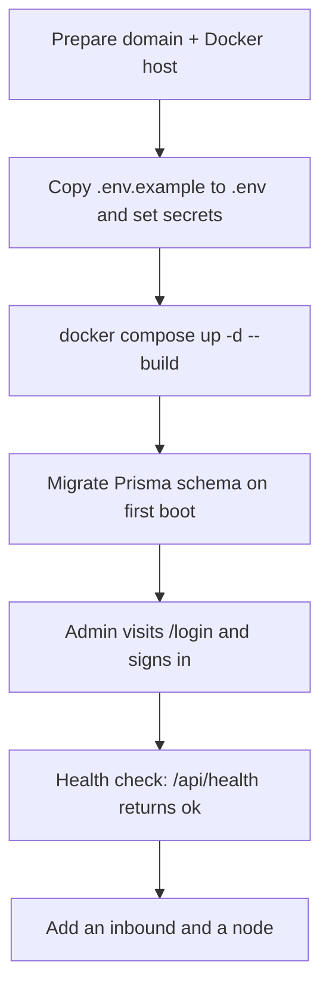
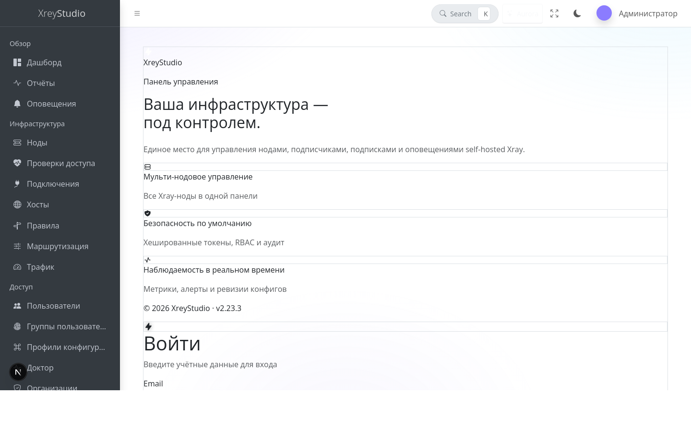
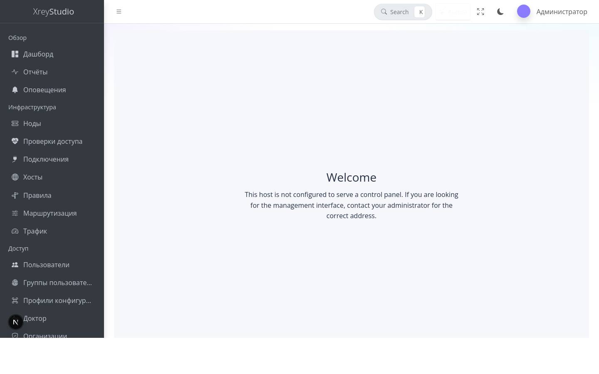
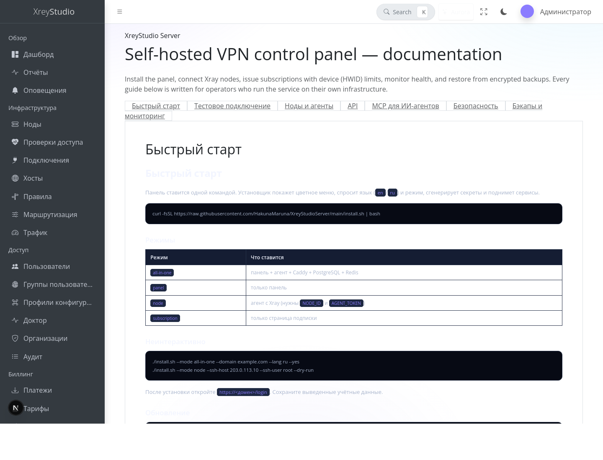
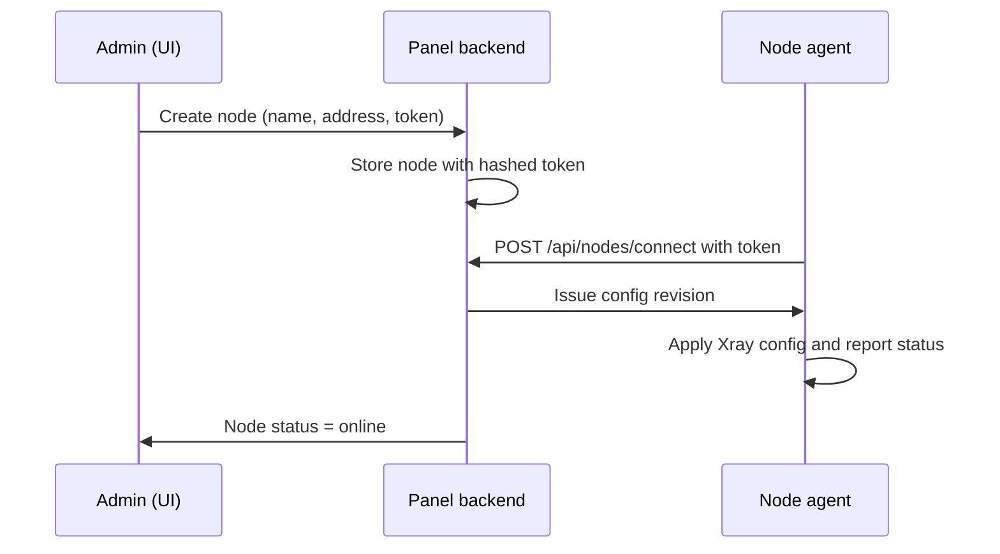
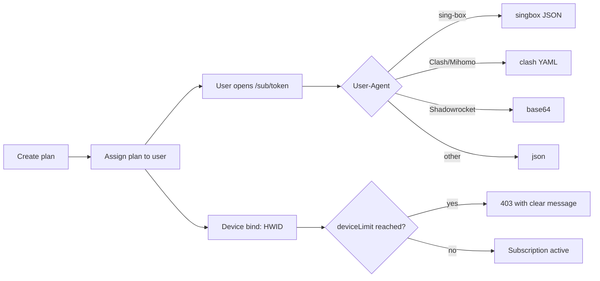
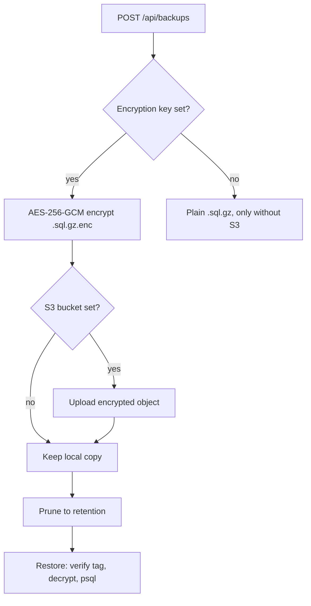

# Operational processes

This guide describes the end-to-end workflows of a XreyStudio Server installation: what an
operator does, what the backend does, and how to verify that the step succeeded. For API field
details see [api.md](api.md); for installation commands see [install.md](install.md).

## 1. First installation

1. **Prepare the host.** Install Docker and Compose, open ports 80/443 (and the ports used by
   your nodes), and point `DOMAIN` at the host. Never commit the resulting `.env`.
2. **Configure secrets.** Set `JWT_SECRET`, `ADMIN_EMAIL`, `ADMIN_PASSWORD`, `DATABASE_URL` and,
   if backups leave the host, `BACKUP_ENCRYPTION_KEY`. Generate keys with `openssl rand -base64 32`.
3. **Start the stack.** `docker compose up -d --build`. The backend waits for PostgreSQL, applies
   the Prisma schema and boots the HTTP API on port 3000.
4. **Verify.** `curl -fsS https://$DOMAIN/api/health` must return `ok`. Sign in at `/login`; the
   dashboard shows the current user and organization. If the page is empty, open the browser
   console and check that `NEXT_PUBLIC_API_URL` points at the reachable backend.
5. **Roll back.** Keep the previous image tag in `docker-compose.yml`; to revert, change the tag,
   run `docker compose up -d`, and restore the previous database backup using
   [backup.md](backup.md) **before** starting the old backend if the schema changed.

The sign-in screen looks like this:

When `PANEL_DECOY=true` is enabled, the public address renders a neutral placeholder unless the
operator uses the secret entry path (`/<PANEL_ENTRY_PATH>/login`) or already has the
`xss_ui_access` cookie set after a successful login. Subscription links and the API keep working.
This protects the admin panel from casual scanning:

The public documentation is deliberately reachable at `/docs` and is listed in `sitemap.xml`:

## 2. Connecting a node

1. In **Nodes** click **Add node**, enter a descriptive name, host and port. The panel generates a
   node token; copy it once — only its hash is stored.
2. On the host, install the agent (`docs/node-onboarding.md`) and put the token in the agent
   environment. The agent authenticates with the token and pulls the current config revision.
3. Verify in the UI: the node turns green, the last-seen timestamp refreshes, and traffic appears
   in **Traffic** within a few minutes. If it stays offline, run `/doctor` (see below) and check
   outbound connectivity to the panel URL.
4. Profile binding: in **Config profiles** choose the target node. Users assigned that profile are
   then routed through this node; `/api/metrics/nodes/:id/traffic` shows per-node traffic.

## 3. Issuing a subscription

1. Create a plan in **Plans** with a traffic limit and `deviceLimit`. The limit is enforced by the
   `Device` table: each client registers a stable browser/client HWID through `/api/devices/bind`.
2. Share the subscription link with the user. Opening it in a browser shows a human-readable
   page; a VPN client receives the machine-readable config in the format selected from its
   User-Agent. An explicit `?format=raw|base64|clash|singbox|json` override is validated by the
   backend.
3. If the user reaches the device limit, the response is `403` with a message explaining that an
   old device must be removed. Repeated bind attempts are rate-limited (`429`).
4. To revoke access, delete the user's devices or disable the subscription; traffic accounting
   continues in the background so the reports stay accurate.

## 4. Health checks and Doctor

1. **Health checks** (`/health-checks`) probe node HTTP endpoints on a schedule. A failed probe
   records an event and optionally sends a notification through the routing rules.
2. **Doctor** (`/doctor`) runs diagnostics: database connectivity, config consistency, stale node
   revisions and TLS validity. Checks are read-only; the only permitted repair is `stale_revision`
   on an `ONLINE` node, and it simply reapplies the current config revision.
3. Read the output top to bottom: each check has a status and an explanation. A stale revision
   means the agent has not applied the newest config; a geocheck mismatch means the node's exit IP
   changed. Treat warnings as investigation prompts, and use the fix button only for a whitelisted,
   fixable check.

## 5. Backup and restore

1. Generate `BACKUP_ENCRYPTION_KEY` and store it in a password manager, **not** in the repository.
2. Create a snapshot from **Backups** or `make backup`. Encrypted files end in `.sql.gz.enc`.
3. If a bucket is configured, confirm the object appears there; a missing encryption key aborts
   the backup instead of uploading plaintext.
4. Restore only in a maintenance window: take a fresh snapshot first, then call
   `POST /api/backups/:name/restore` with `{ "confirm": true }` (or `scripts/restore.sh`). The
   service decrypts and verifies the GCM tag before running `psql`.
5. Rehearse the whole flow quarterly using [runbooks/backup-restore-drill.md](runbooks/backup-restore-drill.md).

## 6. Recovery tools

- **Telegram bot** (`TELEGRAM_BOT_TOKEN`, `TELEGRAM_WEBHOOK_SECRET`): `/login` sends a one-time
  signed link tied to the operator's chat id; `/status` reports whether that chat id is linked.
  The webhook secret is passed in the `X-Telegram-Bot-Api-Secret-Token` header, never in the URL.
- **Rescue CLI** (`npm run rescue -- list-admins|reset-password|promote|demote`): use it when no
  admin can sign in. New passwords come from `RESCUE_NEW_PASSWORD` or an interactive prompt, never
  from command-line arguments. The last active admin cannot be demoted.
- **MCP write-plan**: an external agent proposes a user status change; the panel stores the plan
  for five minutes and applies it only after the owner submits a one-time approval token from
  `MCP_APPROVAL_TOKEN`. Every step is written to the audit log.

## 7. Search visibility

Public documentation is server-rendered at `/docs`, listed in `/sitemap.xml`, and described in
`/robots.txt`. Private routes (`/login`, `/sub/*`, dashboards) carry `noindex`. Set
`NEXT_PUBLIC_SITE_URL` to the external origin so canonical and Open Graph links are correct.
Canonical URLs use that origin rather than the request `Host` header to avoid host-header poisoning.
