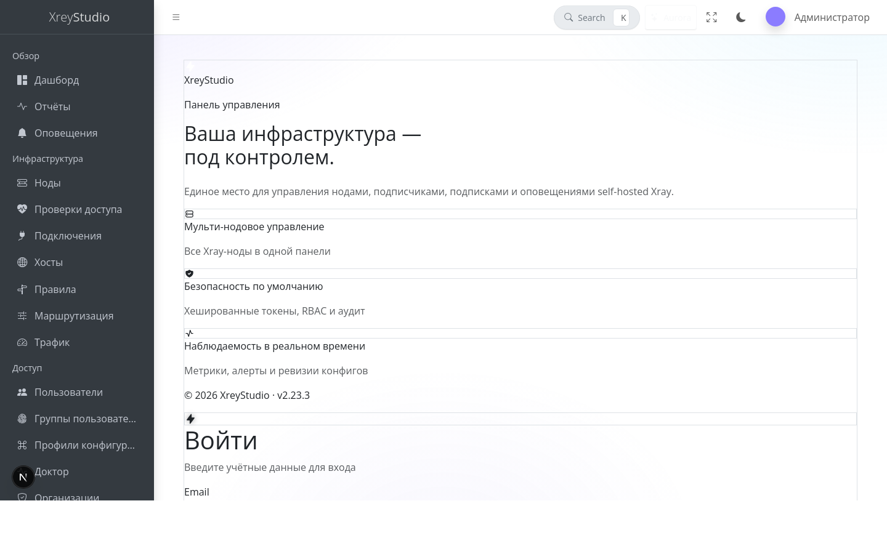
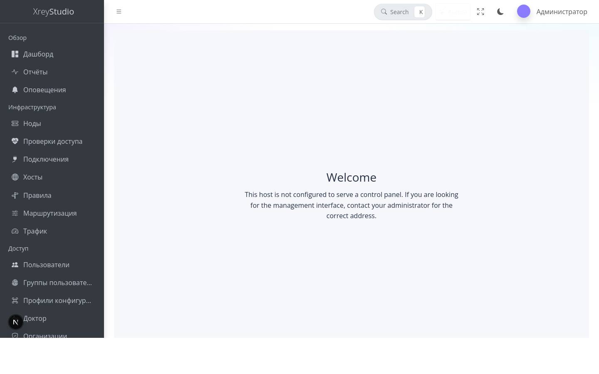
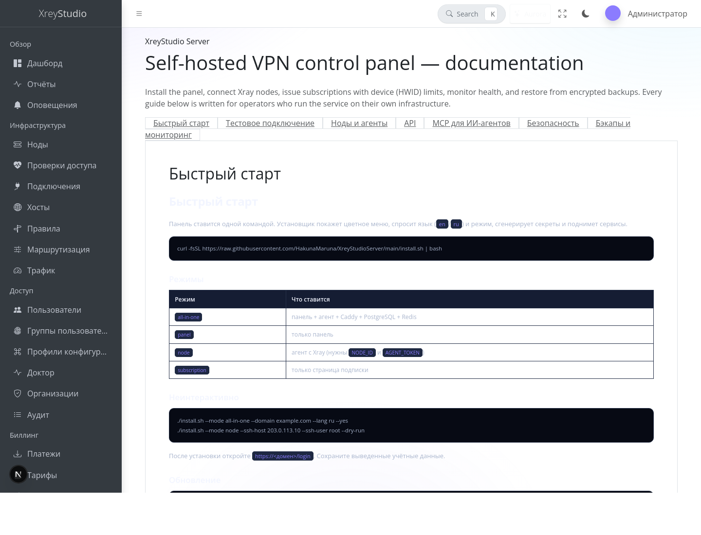

# Operator UI guide

This guide walks through the screens an operator sees and what each step accomplishes. Screenshots
were captured from the AdminLTE default UI; Aurora remains available with `NEXT_PUBLIC_UI=aurora`.

## Sign in

1. Open `https://<your-domain>/login`.
2. Enter the administrator email and password created during installation.
3. On success the dashboard opens. On failure the page shows a generic message; check the backend
   logs rather than trying repeatedly, because repeated failures are rate-limited.
4. If `PANEL_DECOY=true`, the public address shows the neutral placeholder below. Reach the panel
   through the secret entry (`/<PANEL_ENTRY_PATH>/login`) or, after a successful login, via the
   routing cookie set by the middleware.

## Public documentation

Documentation is published at `/docs` without authentication. It is server-rendered, linked from
`sitemap.xml` and described in `robots.txt`. Private pages are marked `noindex`, so search engines
see only public product information and never a session-specific subscription link.

## Daily workflow

| Screen | What you do | Result |
| --- | --- | --- |
| **Dashboard** | Check active users, traffic and recent events | Fast health overview |
| **Nodes** | Add a node, copy its token once, watch status | Agent connects and receives configs |
| **Inbounds** | Define ports and protocols | Users can connect |
| **Config profiles** | Bind a profile to a node | Traffic for that profile goes to that node |
| **Users / Plans** | Create a user, assign a plan and `deviceLimit` | Subscription link becomes active |
| **Traffic** | Filter by period and node | Usage reports and billing data |
| **Health checks** | Review failed probes | Notifications routed by event rules |
| **Doctor** | Run diagnostics, fix only whitelisted `stale_revision` | Config stays consistent |
| **Backups** | Create, list and restore encrypted snapshots | Recovery point is available |

## Adding a user with a device limit

1. Open **Plans** and create a plan with the allowed traffic and `deviceLimit`.
2. Open **Users**, create the user, select the plan and copy the `/sub/<token>` link.
3. Ask the user to open the link in the VPN client. The client registers its HWID through
   `/api/devices/bind`. Once `deviceLimit` is reached, the UI shows a clear 403 message and further
   bind attempts receive 429.
4. To free a slot, open the user's **Devices** list and delete the stale device.

## Creating an encrypted backup

1. Set `BACKUP_ENCRYPTION_KEY` in `.env` before enabling a bucket. Without it, S3 uploads are
   refused so plaintext data cannot leave the host.
2. Open **Backups** and click **Create**. The file appears as `<timestamp>.sql.gz.enc`.
3. If S3 is configured, confirm the object appears in the bucket with the same size.
4. Restore only from **Backups** with the confirmation step, or use `scripts/restore.sh` from the
   host console. The GCM tag is verified before any SQL is applied.
5. Follow [runbooks/backup-restore-drill.md](runbooks/backup-restore-drill.md) for a quarterly drill.

## Troubleshooting quick reference

- **Node offline** → verify the token, panel URL and firewall; see
  [runbooks/incident-node-offline.md](runbooks/incident-node-offline.md).
- **Subscription shows empty config** → check that a plan and inbound exist, then open the link
  with `?format=json` to bypass User-Agent detection.
- **Doctor warns about a stale revision** → confirm the node is online, then use the fix action.
- **No admin can sign in** → use the Rescue CLI; see [processes.md](processes.md#6-recovery-tools).
